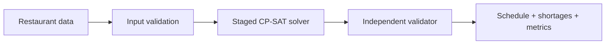

# ShiftSense

**Restaurant scheduling that recovers from last-minute call-outs.**

When someone calls in sick, most scheduling apps post an open shift and hope someone
picks it up. ShiftSense computes the best fix instead: it keeps the shift covered while
changing as few other people's schedules as possible, and every schedule it produces is
checked by an independent validator.

Built for single-location restaurants with about 10–40 staff.

> **Status:** the scheduling engine is complete and tested. The FastAPI backend,
> PostgreSQL database and Next.js dashboard are in development.

## What it does

- **Generates weekly schedules** with Google OR-Tools (CP-SAT), respecting skills,
  availability, overlapping shifts, maximum hours, minimum rest and split shifts.
- **Repairs call-outs with minimal disruption.** Coverage comes first, then the fewest
  changes to the published schedule, then fairness.
- **Handles real restaurant shifts:** several roles per shift (cooks, servers, hosts),
  overnight closes, weekly availability with date-specific exceptions, and timezones.
- **Reports shortages honestly.** When a shift can't be fully staffed, it returns the best
  possible schedule and lists exactly which positions are short, instead of failing.
- **Balances hours fairly** around each employee's preferred hours, not just equal hours.
- **Respects manager decisions** with locks: keep someone on a shift, or keep them off it.
- **Verifies every result.** A separate validator, written without the solver, checks
  every schedule and repair before it is returned.

## Results

Measured on synthetic restaurants (5 seeds per size, one laptop):

| Staff | Schedule generation (median) | Call-out repair (median) | Changes per repair |
|---|---|---|---|
| 25 | 0.56 s | 0.32 s | 1–2 |
| 40 | 1.93 s | 0.41 s | 1–2 |

Every returned schedule passed independent validation. Full results and notes:
[docs/benchmarks.md](docs/benchmarks.md).

## How it works



The solver optimizes in strict priority order, one stage at a time, so a lower priority
can never make a higher one worse:

1. Fill as many positions as possible
2. Change as few existing assignments as possible (repairs)
3. Get each employee as close as possible to their preferred hours
4. Avoid concentrating the remaining difference on one person
5. Balance hours among employees with no stated preference

Each stage shares a time budget. If a later stage runs out of time, the last valid
schedule is kept and the result is reported as `FEASIBLE` rather than `OPTIMAL`.

## Quick start

Requires Python 3.12.

```bash
git clone https://github.com/fernandochristen2004-sys/ShiftSense.git
cd ShiftSense
python -m venv .venv

# Windows
.venv\Scripts\activate
# macOS / Linux
source .venv/bin/activate

pip install -r requirements.txt
```

Run the tests:

```bash
python -m pytest -q
```

Run the demo schedule:

```bash
python -m optimizer.demo
```

Run the benchmark (generate, simulate a call-out, repair, validate):

```bash
python -m scripts.benchmark
python -m scripts.benchmark --sizes 25 40 --seeds 10
```

## Project structure

```
optimizer/
  engine.py            Entry point: generate() and repair()
  models.py            Employees, shifts, requirements, policies, results
  solver.py            CP-SAT model and constraints
  staged_solver.py     Priority-ordered optimization with a shared time budget
  repair.py            Repair input checks and assignment-change counting
  validator.py         Independent schedule validation
  input_validator.py   Dataset validation before solving
  lock_conflicts.py    Explanations for conflicting locks
  coverage_metrics.py  Staffing shortages, calculated independently
  schedule_metrics.py  Fairness and workload measurements
  timeutils.py         Shared time, rest and availability rules
  synthetic_data.py    Reproducible synthetic restaurants for tests and benchmarks
  sample_data.py       Small hand-made example for the demo and tests
  demo.py              Command-line demo
scripts/
  benchmark.py         Speed check and end-to-end call-out runs
tests/                 Automated tests (pytest)
docs/                  Schema, benchmarks and known limitations
```

## Documentation

- [Database schema](docs/schema.md): the planned PostgreSQL design
- [Benchmarks](docs/benchmarks.md): measured generation and repair times
- [Known limitations](docs/limitations.md): what the engine does not do yet

## Roadmap

- [x] Constraint-based scheduling engine with multi-role shifts and overnight closes
- [x] Minimal-disruption call-out repair with partial coverage
- [x] Target-based fairness and staged optimization
- [x] Independent validation, synthetic data and benchmarks
- [ ] FastAPI backend and PostgreSQL database
- [ ] Next.js manager dashboard
- [ ] Ranked replacement suggestions with explanations
- [ ] Single-point-of-failure detection (shifts only one person can cover)
- [ ] Plain-language explanations when a schedule is impossible
- [ ] Docker, CI and cloud deployment

## Tech stack

Python 3.12 · Google OR-Tools (CP-SAT) · pytest

Planned: FastAPI · PostgreSQL · SQLAlchemy · Alembic · Next.js · TypeScript · Tailwind CSS ·
Docker · GitHub Actions
