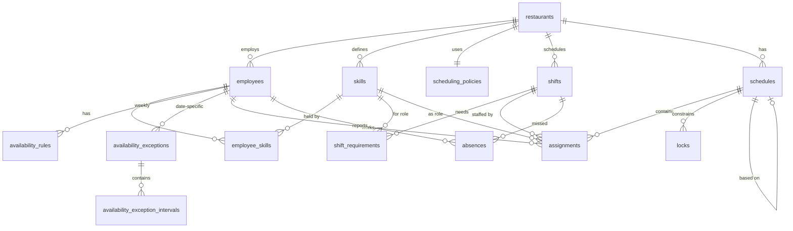

# Database schema (draft)

PostgreSQL schema for ShiftSense, planned before Phase B. It mirrors the
engine's dataclasses so that loading data for the solver is a direct
translation, not a redesign.

## Overview

## Conventions

- **IDs:** `bigint generated always as identity`. Internal only; never shown to managers.
- **Times:** every point in time is `timestamptz`, stored in UTC. The restaurant's
  `timezone` is used to show local times and is passed to the engine as the
  scheduling timezone for weekly availability and exceptions.
- **Durations and limits** are stored as integer minutes (`*_minutes`). While the engine
  still uses whole hours for maximum hours and minimum rest, those columns only accept
  whole hours (see "Design decisions").
- **Every table belongs to a restaurant.** ShiftSense targets one location, but this
  keeps data separated and makes a demo restaurant easy.
- **Restaurant boundaries are enforced by the database.** Every table that links two
  restaurant-owned records stores `restaurant_id` and uses composite foreign keys such
  as `(restaurant_id, employee_id) → employees (restaurant_id, id)`. An assignment can
  never connect one restaurant's employee to another restaurant's shift. To allow this,
  `employees`, `skills`, `shifts` and `schedules` each have `unique (restaurant_id, id)`.
- **Nothing that has history is hard-deleted.** Employees become `inactive`; schedules
  become `archived`; published shifts become `cancelled`. Foreign keys use
  `ON DELETE RESTRICT` unless stated otherwise.
- **Enums** are `text` with a `CHECK` constraint (easier to change than PostgreSQL enums).

## Tables

### restaurants

| Column | Type | Notes |
|---|---|---|
| id | bigint PK | |
| name | text not null | |
| timezone | text not null | IANA name, e.g. `Asia/Colombo` |
| created_at | timestamptz not null | default `now()` |

### employees

| Column | Type | Notes |
|---|---|---|
| id | bigint PK | |
| restaurant_id | bigint FK → restaurants | |
| employee_number | text null | Payroll/POS number. Unique per restaurant when present |
| display_name | text not null | Shown on the schedule |
| phone | text null | For call-out contact |
| status | text not null | `active` / `inactive` |
| max_minutes | int not null | `>= 0`. Whole hours only for now: `max_minutes % 60 = 0` |
| target_minutes | int null | `null` = no preference. `0 <= target <= max` |
| created_at, updated_at | timestamptz not null | |

Constraints: `unique (restaurant_id, id)`, `unique (restaurant_id, employee_number)`
(nulls allowed), `check (target_minutes is null or target_minutes between 0 and max_minutes)`.

### skills

| Column | Type | Notes |
|---|---|---|
| id | bigint PK | |
| restaurant_id | bigint FK → restaurants | |
| name | text not null | `cook`, `server`, ... Unique per restaurant |

Constraints: `unique (restaurant_id, id)`, `unique (restaurant_id, name)`.

### employee_skills

| Column | Type | Notes |
|---|---|---|
| restaurant_id | bigint not null | |
| employee_id | bigint | FK `(restaurant_id, employee_id)` → employees. `ON DELETE CASCADE` |
| skill_id | bigint | FK `(restaurant_id, skill_id)` → skills |

Primary key: `(employee_id, skill_id)`.

### availability_rules (recurring, weekly)

Engine: `WeeklyAvailability(weekday, start_time, end_time)`.

| Column | Type | Notes |
|---|---|---|
| id | bigint PK | |
| employee_id | bigint FK → employees | `ON DELETE CASCADE` |
| weekday | smallint not null | 0 = Monday … 6 = Sunday, local time |
| start_time | time not null | Local wall-clock time, minute precision |
| end_time | time not null | `<> start_time`. Earlier than `start_time` means the window crosses midnight |

### availability_exceptions (date-specific)

Engine: `AvailabilityException(date, available, intervals)`. An exception replaces the
employee's weekly availability for that whole local date.

| Column | Type | Notes |
|---|---|---|
| id | bigint PK | |
| employee_id | bigint FK → employees | `ON DELETE CASCADE` |
| local_date | date not null | Date in the restaurant's timezone |
| available | boolean not null | `false` = off all day. `true` = only the listed intervals |
| note | text null | e.g. "exam" |

Unique: `(employee_id, local_date)`, matching the engine's "no duplicate exception dates".

### availability_exception_intervals

| Column | Type | Notes |
|---|---|---|
| id | bigint PK | |
| exception_id | bigint FK → availability_exceptions | `ON DELETE CASCADE` |
| start_time | time not null | Local wall-clock time, minute precision |
| end_time | time not null | `check (end_time > start_time)`. Same day only, no midnight crossing |

Rule (enforced in the application, since it spans two tables): an `available` exception
has at least one interval; an unavailable one has none.

### scheduling_policies

One row per restaurant (`restaurant_id` is both PK and FK).

| Column | Type | Engine field |
|---|---|---|
| restaurant_id | bigint PK, FK | |
| minimum_rest_minutes | int not null | `minimum_rest_hours` × 60. Whole hours only for now: `% 60 = 0` |
| enforce_minimum_rest | boolean not null | same |
| allow_split_shifts | boolean not null | same |
| split_shift_min_break_minutes | int not null | same. `> 0` |
| max_split_span_minutes | int not null | same. `> split_shift_min_break_minutes` |
| fairness_enabled | boolean not null | same |
| allow_partial_coverage | boolean not null | same |
| updated_at | timestamptz not null | |

### shifts

| Column | Type | Notes |
|---|---|---|
| id | bigint PK | |
| restaurant_id | bigint FK → restaurants | |
| label | text null | "Friday dinner" |
| starts_at | timestamptz not null | |
| ends_at | timestamptz not null | `check (ends_at > starts_at)`; may cross midnight |
| status | text not null | `active` / `cancelled`. Published shifts are replaced, not edited |

Constraints: `unique (restaurant_id, id)`. Index: `(restaurant_id, starts_at)` for loading a week.

### shift_requirements

| Column | Type | Notes |
|---|---|---|
| id | bigint PK | |
| restaurant_id | bigint not null | |
| shift_id | bigint | FK `(restaurant_id, shift_id)` → shifts. `ON DELETE CASCADE` |
| skill_id | bigint | FK `(restaurant_id, skill_id)` → skills |
| count | int not null | Target |
| min_count | int not null | `check (0 <= min_count and min_count <= count)`. Equal to `count` when no shortfall is allowed |

Unique: `(shift_id, skill_id)`, matching "no duplicate roles in a shift".

### schedules (revisions)

A schedule is one revision of the staffing for a planning window. Repairs and
manual edits create a new revision; old revisions are kept.

| Column | Type | Notes |
|---|---|---|
| id | bigint PK | |
| restaurant_id | bigint FK → restaurants | |
| period_start | timestamptz not null | Planning window |
| period_end | timestamptz not null | `> period_start` |
| revision_number | int not null | 1, 2, 3 … per restaurant and period. Shown to managers |
| based_on_id | bigint null | FK `(restaurant_id, based_on_id)` → schedules. The revision this one came from |
| status | text not null | `draft` / `published` / `archived` |
| row_version | int not null | Optimistic concurrency. Every update must match the expected value and increments it |
| solver_status | text null | `OPTIMAL` / `FEASIBLE` / ... |
| fully_covered | boolean null | |
| shortages | jsonb not null | Snapshot of `StaffingShortage` list, default `[]` |
| objective_values | jsonb not null | Stage results, default `{}` |
| schedule_metrics | jsonb not null | Measured metrics, default `{}` |
| assignment_changes | int null | Repairs only |
| created_at | timestamptz not null | |
| published_at | timestamptz null | |

Constraints:
- `unique (restaurant_id, id)`
- `unique (restaurant_id, period_start, revision_number)`
- At most one `published` schedule per restaurant and period
  (partial unique index on `(restaurant_id, period_start) where status = 'published'`).

### assignments

| Column | Type | Notes |
|---|---|---|
| id | bigint PK | |
| restaurant_id | bigint not null | |
| schedule_id | bigint | FK `(restaurant_id, schedule_id)` → schedules. `ON DELETE CASCADE` |
| shift_id | bigint | FK `(restaurant_id, shift_id)` → shifts |
| employee_id | bigint | FK `(restaurant_id, employee_id)` → employees |
| skill_id | bigint | FK `(restaurant_id, skill_id)` → skills. The role worked |

Unique: `(schedule_id, shift_id, employee_id)`. This enforces "one role per
person per shift" in the database too.

### locks

| Column | Type | Notes |
|---|---|---|
| id | bigint PK | |
| restaurant_id | bigint not null | |
| schedule_id | bigint | FK `(restaurant_id, schedule_id)` → schedules. The draft the lock applies to. `ON DELETE CASCADE` |
| shift_id | bigint | FK `(restaurant_id, shift_id)` → shifts |
| employee_id | bigint | FK `(restaurant_id, employee_id)` → employees |
| skill_id | bigint null | FK `(restaurant_id, skill_id)` → skills. Required for `must_work`, null for `must_not_work` |
| kind | text not null | `must_work` / `must_not_work` |

Unique: `(schedule_id, shift_id, employee_id)`, so a lock can't say both.
Check: `kind = 'must_not_work' or skill_id is not null`.

### absences (call-outs)

| Column | Type | Notes |
|---|---|---|
| id | bigint PK | |
| restaurant_id | bigint not null | |
| employee_id | bigint | FK `(restaurant_id, employee_id)` → employees |
| shift_id | bigint | FK `(restaurant_id, shift_id)` → shifts |
| reported_at | timestamptz not null | |
| note | text null | |

Unique: `(employee_id, shift_id)`. When loading data for a repair, each absence is
passed to the engine as a `must_not_work` lock for that shift (see "Mapping").

## Mapping to the engine

| Engine | Comes from |
|---|---|
| `Employee.id`, `name` | `employees.id`, `display_name` |
| `Employee.skills` | `employee_skills` joined to `skills.name` |
| `Employee.max_hours` | `employees.max_minutes` ÷ 60 (exact, because only whole hours are stored) |
| `Employee.target_minutes` | `employees.target_minutes` |
| `Employee.weekly_availability` | `availability_rules` → `WeeklyAvailability` |
| `Employee.availability_exceptions` | `availability_exceptions` + their intervals → `AvailabilityException` |
| `Employee.datetime_availability` | Not used for stored data (left as `None`). It remains for tests and synthetic data |
| Scheduling timezone | `restaurants.timezone` |
| `DateTimeShift` | `shifts` where `status = 'active'` |
| `ShiftRequirement(skill, count, min_count)` | `shift_requirements` + `skills.name` |
| `SchedulingPolicy` | `scheduling_policies` (`minimum_rest_hours` = `minimum_rest_minutes` ÷ 60) |
| `FixedAssignment` (outside assignments) | `assignments` of the **published** schedules just before and after the window, not a separate table |
| Locks | `locks` for the draft being solved, plus one `must_not_work` lock per `absences` row |
| Original schedule (repair) | `assignments` of the published schedule |
| `ScheduleResult` | A new `schedules` row + its `assignments` |

## Publishing rule

A schedule can be published only when:

- the engine returned a schedule (`assignments` is not `None`),
- `status` is `OPTIMAL` or `FEASIBLE`, and
- `validation_errors` is empty.

Hard staffing minimums are always met in a returned schedule, so a schedule with
shortages (partial coverage) can be published. The manager must explicitly confirm
publishing when `fully_covered` is `false`, and the shortages are kept in the
`schedules` row. This rule is enforced by the API, not the schema.

Publishing a revision archives the currently published revision for the same period
in the same transaction.

Planning periods are standardized: each period is one local week, starting Monday at
00:00 in the restaurant's timezone. The API enforces this, so published periods never
overlap. A PostgreSQL exclusion constraint can enforce it in the database later.

## Design decisions

- **Minutes in the database, whole hours for now.** The engine still uses `max_hours` and
  `minimum_rest_hours`. Storing minutes avoids a migration later, and the `% 60 = 0`
  checks make sure nothing is silently rounded when converting. Once the engine switches
  to minutes, the checks can be dropped.
- **Two kinds of versioning.** `revision_number` tells people which revision of the week
  they are looking at. `row_version` stops two managers from overwriting each other's
  changes to the same row. They solve different problems, so they are separate columns.
- **Restaurant boundaries are enforced in the database,** with composite foreign keys,
  rather than relying only on application checks.
- **Availability is stored the way the engine reads it.** Weekly rules and date
  exceptions are loaded as they are; the engine turns them into times using the
  restaurant's timezone. Call-outs become `must_not_work` locks, because an employee
  cannot combine weekly availability with one-off datetime availability.
- **Shifts are shared across schedule revisions, and published shifts are replaced, not
  edited.** Repairing creates a new schedule and new assignments, but the shifts themselves
  don't change. To change a shift that a published schedule uses, cancel it
  (`status = 'cancelled'`) and create a new shift in a new draft. Old revisions keep
  pointing to the old shift, so history stays accurate. Only `active` shifts are loaded
  for solving.
- **Failed solve attempts are not stored.** An INFEASIBLE result, lock conflicts or other
  failure reasons are returned in the API response so the manager sees them immediately.
  A history table can be added later if needed.
- **Shortages and metrics are stored as JSON snapshots.** They can always be recomputed,
  so they are a cache for fast display, not the source of truth.
- **Users and authentication** are left out here. Add a `users` table (manager accounts,
  linked to a restaurant) when authentication is built.
